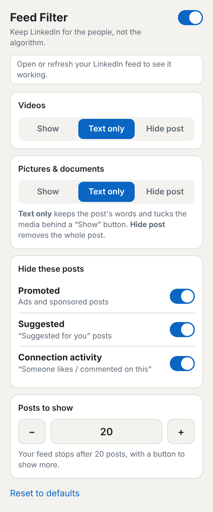

<h1 align="center">LinkedIn Feed Filter</h1>

  A free browser add-on that hides ads, tucks videos and pictures behind a button, 
  and gives your LinkedIn feed an end.

  

> **Not affiliated with LinkedIn.** LinkedIn's [rules](https://www.linkedin.com/help/linkedin/answer/a1341387)
> discourage extensions that change how its site looks. Use at your own risk.

## Install

Works in Chrome, Edge, Brave and Arc.

1. Click **Code → Download ZIP** at the top of this page, then unzip it. Keep the folder: your browser runs the add-on from it.
2. Open `chrome://extensions` (Edge: `edge://extensions`) and turn on **Developer mode**.
3. Click **Load unpacked** and choose the unzipped folder.
4. Open LinkedIn and **refresh the page**. Pin the add-on (puzzle icon) to find it easily.

## Use

Click the icon while on LinkedIn. Changes save instantly.

- **Text only** keeps a post's words and hides its video or picture behind a **Show** button.
- **Posts to show** stops the feed at that number. `0` means no limit.

## Good to know

- Only the home feed is filtered, and ads are detected by their English labels.
- Nothing changed? Refresh the LinkedIn tab.
- A post slipped through? [Open an issue](../../issues).
- **Update:** download the ZIP again, replace the folder, then click the reload arrow on the extension's card.
- **Remove:** click **Remove** on the extensions page.
- **Private:** no tracking, no data collected. Your settings stay in your browser.

<strong>For developers</strong>

 

Manifest V3, no build step. Every selector and keyword lives in `CONFIG` at the top of [content.js](content.js):

| Symptom | Fix |
| --- | --- |
| Popup says "No posts found yet" on a loaded feed | Add a selector to `CONFIG.postRoots`. |
| A promoted / suggested post is still visible | Add its label (lowercase) to `CONFIG.labels`. |
| A video or picture is not tucked away | Add a selector to `CONFIG.videos`, or lower `CONFIG.minMedia`. |
| Hiding media also hides the Like / Comment bar | Add a selector for the bar to `CONFIG.chromeMarkers`. |

After editing, reload the extension's card and refresh LinkedIn.

**Firefox:** add `"browser_specific_settings": { "gecko": { "id": "linkedin-feed-filter@example.com" } }` to `manifest.json`, then load it from `about:debugging` (This Firefox → Load Temporary Add-on).

**Tests:** run `python3 test/serve.py`, open <http://localhost:8765/feed/>, and run `await window.runLfTests()` in the console. They run against a mock of LinkedIn's markup, not the live site. The popup preview is at <http://localhost:8765/popup-preview.html>.

**Known limit:** past your post limit, a tall "Show more" card keeps LinkedIn from loading more posts. This is only checked against the mock. If the feed keeps loading, set the limit to `0` and open an issue.

MIT licensed · <a href="LICENSE">LICENSE</a>

